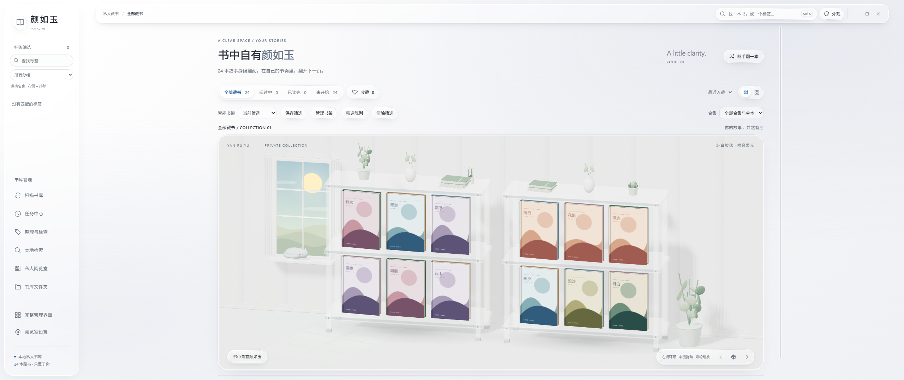
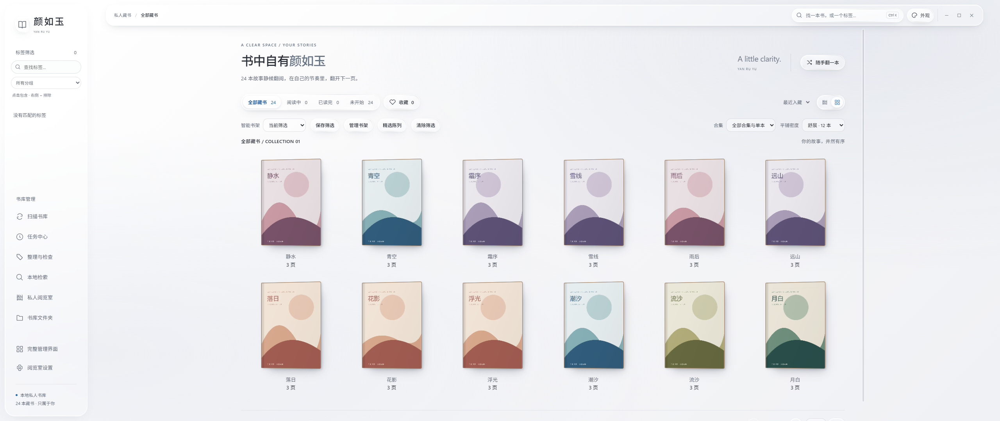

# 颜如玉 · Private Manga Reading Room

[中文](README.md) · **English**

A Windows desktop manga management and reading application customized from exhentai-manga-manager 1.6.15. Current version: **1.6.16**.

## Screenshots

Tested in full-screen mode at 2560 × 1080 using a separate sample library.





## Features

- **3D Bookshelf and Reading Room**: 8 themes, liquid glass interface, room layout, curated displays, ambient sounds, and reading statistics.
- **Library Management**: Comprehensive management interface, smart bookshelf, batch organization, merging of duplicate titles, missing file checks, and undo functionality.
- **Local Reading**: Built-in reader, saved reading progress and preferences, book relocation, and decompression cache subject to storage capacity limits.
- **Local Search**: Aliases, text search, and recommendations for similar books; Windows OCR requires the corresponding language recognition components to be installed on the system.
- **Data Protection**: Backup and restore, corrupted data recovery portal, isolated data directory, and separation of development and testing environments.

## Download and Usage

Download the Windows x64 ZIP from [Releases][releases], extract it to a new folder, and double-click `exhentai-manga-manager.exe`. Node.js is not required for normal use.

Upon first run, the program defaults to using the system user’s app data directory. Create a `data` folder next to the program to enable portable mode; you can also specify the absolute path to a separate data directory via the environment variable `YANRUYU_DATA_DIR`.

Before upgrading, create and verify a backup within the application, exit the old version, and then extract the new version to a new directory. To continue using your old library, follow [Usage and Upgrades][upgrade] to set the original data directory, verify your book list, favorites, and reading progress, and then update the shortcut.

## Development

Environment: **Windows x64, Node.js >=24.5.0, npm**. Electron is fixed at **44.3.0**; dependency versions are controlled by a lock file. An internet connection is required to fetch dependencies during the initial installation, build, or testing.

```powershell
npm ci
npm run dev
```

The development entry point builds the current source code and locked production dependencies into a new `.build/` subdirectory, then launches Electron. Development data is located in `.dev-data/` by default and does not use any existing portable libraries in the project directory. After modifying the source code, close the development window and rerun the command.

| Command | Purpose |
| --- | --- |
| `npm run check` | JavaScript syntax, release source file allowlist, and configuration format |
| `npm test` | Engineering, data protection, reading, organization, retrieval, and desktop isolation regression testing |
| `npm run test:engineering` | Data path isolation, release allowlist, and runtime optimization checks |
| `npm run test:desktop` | Verifies real Electron, IPC, SQLite, and image decoding using a neutral test library |
| `npm run test:backup-desktop` | Verifies backup export, rejection of corrupted packages, restoration, and recovery from corruption |
| `npm run test:all` | All supported regression tests, including isolated desktop tests |
| `npm run build` | Build the application for staging, install locked production dependencies, and generate source code hashes |
| `npm run package` | Generate a Windows x64 application directory and ZIP file without user data |
| `npm run release:audit` | Audit the data exclusion rules and file hashes of the latest release directory |
| `npm run compact -- --current --measure` | Measure the disk space used by the current application |
| `npm run compact -- --current` | Losslessly compress the disk space used by the current application’s runtime files |
| `npm run manager:reference` | Compile the upstream Vue reference project separately |

The test entry point installs runtime dependencies in a new staging directory. The legacy script `tools/test-desktop-gallery.cjs`, which reads the actual library, has been excluded from the unified test entry point. Test artifacts are located in the Git-ignored `tools/.artifacts/` directory or in the system temporary directory.

## Project Structure

| Path | Content |
| --- | --- |
| `resources/app/index.js`, `modules/`, `fileLoader/` | Electron main process, database, and file handling |
| `resources/app/preload.js` | Restricted desktop interface bridge |
| `resources/app/dist/room*.js` and associated modules, CSS | Directly executable, maintainable front-end source code for the reading room |
| `resources/app/dist/assets/` | Preserved artifacts of the current custom management interface and the old reader |
| `resources/app/dist/vendor/` | Bundled frontend dependencies and licenses |
| `resources/extraResources/` | 7-Zip, external reader, and accompanying licenses |
| `source/manager-upstream-v1.6.15/` | Separately compilable upstream Vue reference source code |
| `tools/project/`, `tools/tests/` | Development, build, packaging, auditing, and engineering tests |
| `docs/` | Usage, data isolation, source code origins, and engineering documentation |

The uncompressed JS/CSS files in `dist/` constitute the current maintainable source code and require no additional transpilation. The complete set of local Vue modifications to the management interface and the original sourcemaps have not yet been recovered; `source/` is an upstream reference project, not the complete Vue source for this customized application. The default build preserves the current management interface artifacts; the reference build will not overwrite them. See [Source Code Provenance and Restoration Scope][provenance] for details.

## Data and Release Boundaries

The local working directory contains both existing portable applications and private libraries. Git uses an allowlist, allowing only source code, tools, lock files, licenses, and documentation to be committed. Databases, configurations, reading status, cover art, browser data, caches, backups, installed runtimes, and build outputs are all excluded.

The release script only creates new directories, installs production dependencies from lock files, verifies the hashes of source code and program files, and tests ZIP integrity. It does not overwrite existing installations or migrate libraries. See [Data Directory and Isolation Verification][isolation] for the data path conventions used in development and testing.

Windows NTFS file compression only reduces actual disk usage; it does not alter file content or logical size. Compression attributes may not be preserved after decompression or copying; the `优化程序磁盘占用.ps1` script included in the release package can be run again to reapply them. See [Program Footprint and Cleanup][footprint] for details.

## Documentation and Versions

- [Documentation Index][docs]
- [Change Log](CHANGELOG.md)
- [Usage and Upgrades][upgrade]
- [Source Code Provenance and Scope of Restoration][provenance]
- [Data Directory and Isolation Verification][isolation]
- [Project and Release Acceptance][acceptance]

## Source and License

This project is based on `v1.6.15` of [SchneeHertz/exhentai-manga-manager][upstream], corresponding to commit `a55570b9920da5ffdd6a698c771bbd9a9d52248f`. The upstream attribution is retained, and the customized portions are provided under the [MIT License](LICENSE).

Electron, Three.js, 7-Zip, external reader, and other dependencies are subject to their respective accompanying licenses. For details on upstream sources, retained binaries, and the source recovery boundaries, see [Provenance][provenance].

[releases]: https://github.com/Gazesphotograph/yanruyu-reading-room/releases
[upstream]: https://github.com/SchneeHertz/exhentai-manga-manager
[upgrade]: docs/使用与升级.md
[provenance]: docs/源码来源与恢复范围.md
[isolation]: docs/数据目录与隔离验证.md
[footprint]: docs/程序体积与清理.md
[docs]: docs/README.md
[acceptance]: docs/工程与发布验收.md
