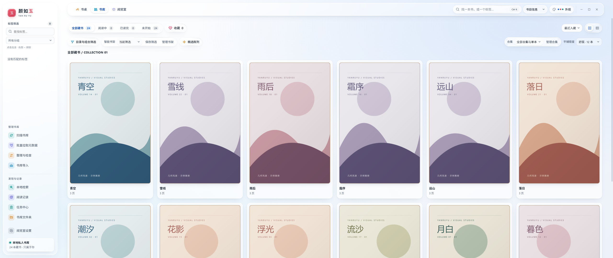

# 颜如玉 · Private Manga Reading Room

[中文](README.md) · **English**

Yanruyu is a local manga library manager and reader for **Windows x64**. Choose a folder of image directories and comic archives to build a searchable library. Resume from the desk, organize books in a table, or browse by cover in a 3D reading room. All three views share the same library and reading history.

**Stable release 2.0.0** · [Download Windows x64 ZIP][download] · [Release notes and checksums][releases]

[Quick start](#quick-start) · [Workspace](#workspace) · [Organize and search](#organize-and-search) · [Data and upgrades](#data-and-upgrades) · [Development](#development)

## Screenshots

These screenshots were captured from the 2.0.0 desktop package at 2560 × 1080 with a separate sample library.

**3D reading room.** Browse the current selection or display books you have picked for your shelves.


**Library grid.** Browse covers or use the controls in the top right to switch to the table for sorting, selection, and batch edits.



## Quick start

1. Download `yanruyu-2.0.0-windows-x64.zip`, extract it to its own folder, and run `exhentai-manga-manager.exe`. Node.js is only needed for development. [Release downloads][releases]
2. On the desk, choose the parent folder where you keep your manga. The scanner reads image folders and ZIP, CBZ, 7z, CB7, RAR, and CBR archives. It builds a catalog and creates covers. Your original files stay in place. Scan status is available in the task center.
3. Open a book from the desk or select a cover in the library to open its details, then start reading. The desk and the reading history make it easy to return to an open book.
4. Switch between cover and table views in the library. Open the selected book in the reading room from its details and return to the same library results when you finish browsing.

To verify your download, run the following command in the folder containing the ZIP and compare the result with `SHA256SUMS.txt`. [Release assets][releases]

```powershell
Get-FileHash -Algorithm SHA256 .\yanruyu-2.0.0-windows-x64.zip
```

## Workspace

| View | What you can do |
| --- | --- |
| **Desk** | Import a library, discover recent additions, resume the last book, and open reading history or featured books |
| **Library** | Browse covers, sort and select rows in the table, or combine folders, tags, favorites, reading status, and collections |
| **Reading room** | Explore the current selection on 3D shelves, adjust the viewpoint, decorate the room, and display featured books |
| **Book details** | Check page count, file path, ratings, tags, and progress. Edit the book, fetch metadata, or reconnect a moved file |

Switching between the library and reading room preserves the query, sort order, page, and selected book. You can choose your startup view in Reading Room Settings.

### Reader

- **Single-page** mode supports fit-to-page and fit-to-width viewing. **Double-page** mode offers a separate cover and shows wide spreads on their own. **Continuous** mode supports scrolling and remembers your position within a page.
- Progress, mode, reading direction, zoom, and display preferences are stored per book. Jump by page number, slider, or thumbnail. Use `G` to enter a page number, `T` for thumbnails, `M` to change mode, and `R` to switch direction.
- Page tools let you copy the current page, use it as the cover, confirm page removal, or switch to another book in the current results. System and Reading Settings lets you choose an external reader, which manages its own page position.
- Archives are extracted on demand. The default cache budget is **2 GB**. Change the limit or clear inactive entries in Settings. [Reader and keyboard reference in Chinese][manual]

### 3D reading room and themes

Drag to look around, scroll to zoom, or use the room controls to reset the view. Configure featured books, room details, ambient audio, and rendering quality. Four themes, **Warm White, Quiet Night, White Liquid Glass, and EX**, apply across the library, reading room, and reader controls. Choose from three rendering quality levels. When WebGL is unavailable, you can continue browsing covers and opening books. [Reading room controls in Chinese][manual]

## Organize and search

- **Filters, collections, and smart shelves.** Add books to a collection by hand. Smart shelves save queries and criteria such as tags, favorites, and reading status, then include new matching books automatically. Folder filters can include subfolders.
- **Individual and batch edits.** Edit the title, author, or cover from book details. Select multiple rows to preview changes to fields such as tags, category, rating, and favorites. Supported operations can be undone in organization history.
- **Missing and duplicate books.** Reconnect a book from its details after changing paths or drives. When the contents match, the app retains its catalog ID, favorites, and reading history. Compare suspected duplicates by path, content fingerprint, and progress before choosing a record to keep.
- **Page text and OCR.** Search book information, book information and text, or page text. Open a text hit at the corresponding page. Windows OCR requires the relevant recognition languages to be installed. Local search also supports aliases and similar-book suggestions.
- **Metadata and tasks.** Look up E-Hentai, ExHentai, or Hentag from book details, or load a local `.ehviewer` file. Preview and apply individual fields. The task center shows scan, extraction, and metadata progress, with cancellation and retries for supported tasks. [Feature and verification matrix in Chinese][matrix]

## Data and upgrades

### Application data and manga files

| Mode | Data location |
| --- | --- |
| Standard | The current Windows user's application data directory |
| Portable | Create `data/` beside the executable or retain the existing legacy `portable` marker |
| Explicit | Set `YANRUYU_DATA_DIR` to an absolute directory path. This setting takes precedence |

The data directory stores the catalog, metadata, favorites, collections, reading history, and settings. Original manga files stay in the library folder you scanned. Use Backup and Restore in Reading Room Settings to export a `.yru-backup` file. Covers are optional, and manga files need a separate backup. The restore flow previews and verifies the backup and creates a recovery point for current data. [Data paths and isolation in Chinese][isolation]

### Upgrade from 1.6.16 or a 2.0 preview

1. Create and verify a backup in the old version, note its data directory, and close the app.
2. Extract 2.0.0 to a new folder. With the standard data directory, launch it under the same Windows account. For portable or custom paths, point the new app at the existing data directory.
3. Check your catalog, favorites, collections, and the page where a book resumes. Update your shortcut after those checks. Classic profiles open in the 2.0 workspace, which can import compatible reading history. [Full upgrade and rollback guide in Chinese][upgrade]

### Common questions

| Situation | What to check |
| --- | --- |
| My library looks empty after upgrading | Check the active data path, especially if the old app used a `portable` marker or a separate `data/` folder |
| A book is still listed after moving it, but it will not open | Check that the new location is accessible, then reconnect the file from book details |
| A large archive fails to open | Check the error in the task center, free disk space, and the extraction cache budget |
| I want to read on a new PC | Transfer both application data and the original manga files, then check library paths and resume positions |

## Development

Environment: **Windows x64, Node.js >=24.5.0, npm**. Electron is fixed at **44.3.0**; dependency versions are controlled by a lock file. An internet connection is required to fetch dependencies during the initial installation, build, or testing.

```powershell
npm ci
npm run dev
```

The development entry point builds the current source code and locked production dependencies into a new `.build/` subdirectory, then launches Electron. Development data is located in `.dev-data/` by default and does not use any existing portable libraries in the project directory. After modifying the source code, close the development window and rerun the command.

| Command | Purpose |
| --- | --- |
| `npm run check` | JavaScript syntax, release source file allowlist, and configuration format |
| `npm run build:ui` | Type-check and build the Vue renderer into `resources/app/dist/app/` |
| `npm run typecheck` | Check Vue and TypeScript types |
| `npm test` | Two-book workspace smoke test for room navigation, narrow windows, and cover fallback |
| `npm run test:engineering` | Data path isolation, release allowlist, and runtime optimization checks |
| `npm run test:desktop` | Verifies real Electron, IPC, SQLite, and image decoding using a neutral test library |
| `npm run test:backup-desktop` | Verifies backup export, rejection of corrupted packages, restoration, and recovery from corruption |
| `npm run test:all` | Full regression suite, including isolated desktop tests. Run when needed to investigate an error or explicitly requested |
| `npm run build` | Build the application for staging, install locked production dependencies, and generate source code hashes |
| `npm run package` | Generate a Windows x64 application directory and ZIP file without user data |
| `npm run package -- --preview` | Build in preview mode with the full application version in the filename |
| `npm run release:audit` | Audit the data exclusion rules and file hashes of the latest release directory |
| `npm run compact -- --current --measure` | Measure the disk space used by the current application |
| `npm run compact -- --current` | Losslessly compress the disk space used by the current application’s runtime files |

The test entry point installs runtime dependencies in a new staging directory. The legacy script `tools/test-desktop-gallery.cjs`, which reads the actual library, has been excluded from the unified test entry point. Test artifacts are located in the Git-ignored `tools/.artifacts/` directory or in the system temporary directory.

## Project Structure

| Path | Content |
| --- | --- |
| `resources/app/index.js`, `resources/app/modules/`, `resources/app/fileLoader/` | Electron main process, database, and file handling |
| `resources/app/preload.js` | Restricted desktop interface bridge |
| `src/renderer/` | Vue, Pinia, and TypeScript renderer source |
| `resources/app/dist/app/` | Generated Vue renderer output |
| `resources/app/dist/room*.js` and associated modules, CSS | Directly executable, maintainable front-end source code for the reading room |
| `resources/app/dist/vendor/` | Bundled frontend dependencies and licenses |
| `resources/extraResources/` | 7-Zip and its accompanying license |
| `tools/project/`, `tools/tests/` | Development, build, packaging, auditing, and engineering tests |
| `docs/` | Usage, data isolation, source code origins, and engineering documentation |

The Vue entry point launches the desktop workspace. The release bundles Vite output alongside the JavaScript and CSS that implement the room and existing views.

## Data and Release Boundaries

The local working directory contains both existing portable applications and private libraries. Git uses an allowlist, allowing only source code, tools, lock files, licenses, and documentation to be committed. Databases, configurations, reading status, cover art, browser data, caches, backups, installed runtimes, and build outputs are all excluded.

The release script only creates new directories, installs production dependencies from lock files, verifies the hashes of source code and program files, and tests ZIP integrity. It does not overwrite existing installations or migrate libraries. See [Data Directory and Isolation Verification][isolation] for the data path conventions used in development and testing.

Windows NTFS file compression only reduces actual disk usage; it does not alter file content or logical size. Compression attributes may not be preserved after decompression or copying; the `优化程序磁盘占用.ps1` script included in the release package can be run again to reapply them. See [Program Footprint and Cleanup][footprint] for details.

## Documentation and Versions

- [Documentation Index][docs]
- [Change Log](CHANGELOG.md)
- [Usage and Upgrades][upgrade]
- [Source Code Provenance and Scope of Restoration][provenance]
- [Data Directory and Isolation Verification][isolation]
- [Project and Release Acceptance][acceptance]

## Source and License

This project is based on `v1.6.15` of [SchneeHertz/exhentai-manga-manager][upstream], corresponding to commit `a55570b9920da5ffdd6a698c771bbd9a9d52248f`. The upstream attribution is retained, and the customized portions are provided under the [MIT License](LICENSE).

Electron, Three.js, 7-Zip, and other dependencies are subject to their respective accompanying licenses. For details on upstream sources, retained binaries, and the source recovery boundaries, see [Provenance][provenance].

[releases]: https://github.com/Gazesphotograph/YanRuYu-Reading-Room/releases/tag/v2.0.0
[upstream]: https://github.com/SchneeHertz/exhentai-manga-manager
[upgrade]: docs/使用与升级.md
[provenance]: docs/源码来源与恢复范围.md
[isolation]: docs/数据目录与隔离验证.md
[footprint]: docs/程序体积与清理.md
[docs]: docs/README.md
[acceptance]: docs/工程与发布验收.md
[download]: https://github.com/Gazesphotograph/YanRuYu-Reading-Room/releases/download/v2.0.0/yanruyu-2.0.0-windows-x64.zip
[matrix]: docs/颜如玉2.0功能验收矩阵.md
[manual]: 颜如玉阅览室说明.md
