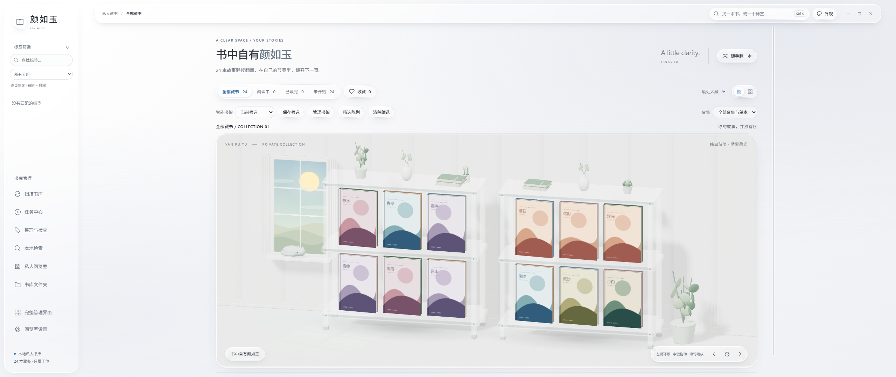
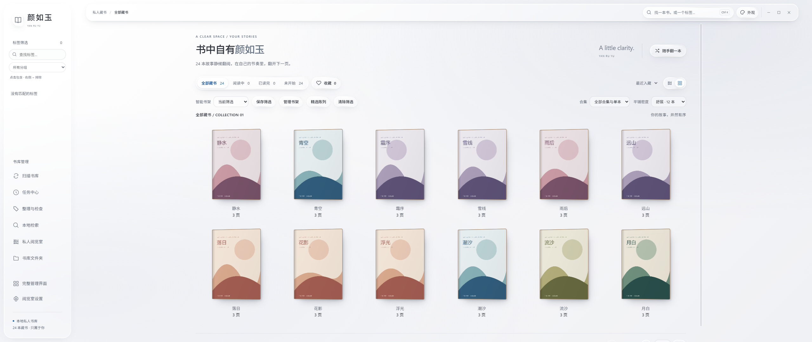

# 颜如玉 · 私人漫画阅览室

**中文** · [English](README.en.md)

基于 exhentai-manga-manager 1.6.15 定制的 Windows 桌面漫画管理与阅读应用。当前版本：**1.6.16**。

## 界面预览

2560 × 1080 全屏实测，使用独立的示例书库。





## 功能

- **3D 书架与阅览室**：8 套主题、液态玻璃界面、房间布置、精选陈列、环境音与阅读统计。
- **书库管理**：完整管理界面、智能书架、批量整理、重复书目合并、缺失文件检查与可撤销操作。
- **本地阅读**：内置阅读器、阅读进度与偏好保存、书籍重新定位、受容量预算约束的解压缓存。
- **本地检索**：别名、文本搜索、相似书推荐；Windows OCR 需要系统已安装相应语言的识别组件。
- **数据保护**：备份与恢复、损坏数据恢复入口、独立的数据目录、开发与测试隔离。

## 下载与使用

从 [Releases][releases] 下载 Windows x64 ZIP，解压到新文件夹，双击 `exhentai-manga-manager.exe`。普通使用无需安装 Node.js。

首次运行默认使用系统用户应用数据目录。在程序旁创建 `data` 文件夹可启用便携模式；也可以通过环境变量 `YANRUYU_DATA_DIR` 指定独立数据目录的绝对路径。

升级前请在应用内创建并验证备份，退出旧版，再将新版解压到新目录。若要继续使用旧书库，按 [使用与升级][upgrade] 设置原数据目录，确认书目、收藏和阅读进度后再更新快捷方式。

## 开发

环境：**Windows x64、Node.js >=24.5.0、npm**。Electron 固定为 **44.3.0**，依赖版本由锁文件控制。首次安装、构建或测试需要联网获取依赖。

```powershell
npm ci
npm run dev
```

开发入口把当前源码和锁定生产依赖构建到新的 `.build/` 子目录，再启动 Electron。开发数据默认位于 `.dev-data/`，不会使用项目目录中的现有便携书库。修改源码后关闭开发窗口并重新运行。

| 命令 | 用途 |
| --- | --- |
| `npm run check` | JavaScript 语法、发布源文件允许列表与配置格式 |
| `npm test` | 工程、数据保护、阅读、整理、检索及隔离桌面回归 |
| `npm run test:engineering` | 数据路径隔离、发布允许列表与精简运行时检查 |
| `npm run test:desktop` | 使用中性测试书库验证真实 Electron、IPC、SQLite 与图片解码 |
| `npm run test:backup-desktop` | 验证备份导出、坏包拒绝、恢复与损坏恢复入口 |
| `npm run test:all` | 全部受支持回归，包括隔离桌面测试 |
| `npm run build` | 构建应用 staging，安装锁定生产依赖并生成源码哈希 |
| `npm run package` | 生成不含用户数据的 Windows x64 程序目录与 ZIP |
| `npm run release:audit` | 复核最近发布目录的数据排除规则与文件哈希 |
| `npm run compact -- --current --measure` | 测量当前程序的磁盘占用 |
| `npm run compact -- --current` | 无损压缩当前程序运行文件的磁盘占用 |
| `npm run manager:reference` | 单独编译上游 Vue 参考工程 |

测试入口会在新 staging 安装运行依赖。历史脚本 `tools/test-desktop-gallery.cjs` 会读取真实书库，已从统一测试入口排除。测试产物位于被 Git 忽略的 `tools/.artifacts/` 或系统临时目录。

## 项目结构

| 路径 | 内容 |
| --- | --- |
| `resources/app/index.js`、`modules/`、`fileLoader/` | Electron 主进程、数据库与文件处理 |
| `resources/app/preload.js` | 受限桌面接口桥接 |
| `resources/app/dist/room*.js` 与配套模块、CSS | 直接运行、可维护的阅览室前端源码 |
| `resources/app/dist/assets/` | 当前定制管理界面与旧阅读器的保留产物 |
| `resources/app/dist/vendor/` | 随附前端依赖及许可证 |
| `resources/extraResources/` | 7-Zip、外部阅读器及随附许可证 |
| `source/manager-upstream-v1.6.15/` | 可单独编译的上游 Vue 参考源码 |
| `tools/project/`、`tools/tests/` | 开发、构建、打包、审计与工程测试 |
| `docs/` | 使用、数据隔离、源码来源与工程文档 |

`dist/` 中未压缩的 JS/CSS 本身就是当前可维护源码，无需额外转译。管理界面的全部本地 Vue 修改和原 sourcemap 尚未恢复，`source/` 是上游参考工程，不能等同于定制版本的完整 Vue 源码。默认构建保留当前管理界面产物；参考构建不会覆盖它。详见 [源码来源与恢复范围][provenance]。

## 数据与发布边界

本地工作目录同时包含现有便携程序和私人书库，Git 使用允许列表，只提交源码、工具、锁文件、许可证和文档。数据库、配置、阅读状态、封面、浏览器资料、缓存、备份、安装运行时与构建输出均被排除。

发布脚本只创建新目录，从锁文件安装生产依赖，核验源码与程序文件哈希，并测试 ZIP 完整性。它不会覆盖现有安装或迁移书库。开发与测试的数据路径契约见 [数据目录与隔离验证][isolation]。

Windows NTFS 文件压缩仅减少实际磁盘占用，不改变文件内容或逻辑大小。解压或复制后压缩属性可能不保留，发布包内的 `优化程序磁盘占用.ps1` 可再次应用。详见 [程序体积与清理][footprint]。

## 文档与版本

- [文档索引][docs]
- [更新日志](CHANGELOG.md)
- [使用与升级][upgrade]
- [源码来源与恢复范围][provenance]
- [数据目录与隔离验证][isolation]
- [工程与发布验收][acceptance]

## 来源与许可

本项目基于 [SchneeHertz/exhentai-manga-manager][upstream] 的 `v1.6.15`，对应提交 `a55570b9920da5ffdd6a698c771bbd9a9d52248f`。保留上游署名，定制部分按 [MIT License](LICENSE) 提供。

Electron、Three.js、7-Zip、外部阅读器及其他依赖遵循各自随附的许可证。上游来源、保留二进制与源码恢复边界详见 [来源说明][provenance]。

[releases]: https://github.com/Gazesphotograph/yanruyu-reading-room/releases
[upstream]: https://github.com/SchneeHertz/exhentai-manga-manager
[upgrade]: docs/使用与升级.md
[provenance]: docs/源码来源与恢复范围.md
[isolation]: docs/数据目录与隔离验证.md
[footprint]: docs/程序体积与清理.md
[docs]: docs/README.md
[acceptance]: docs/工程与发布验收.md
