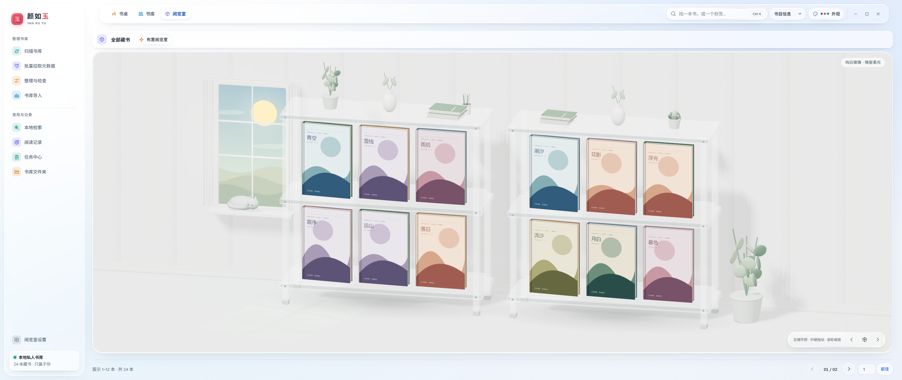
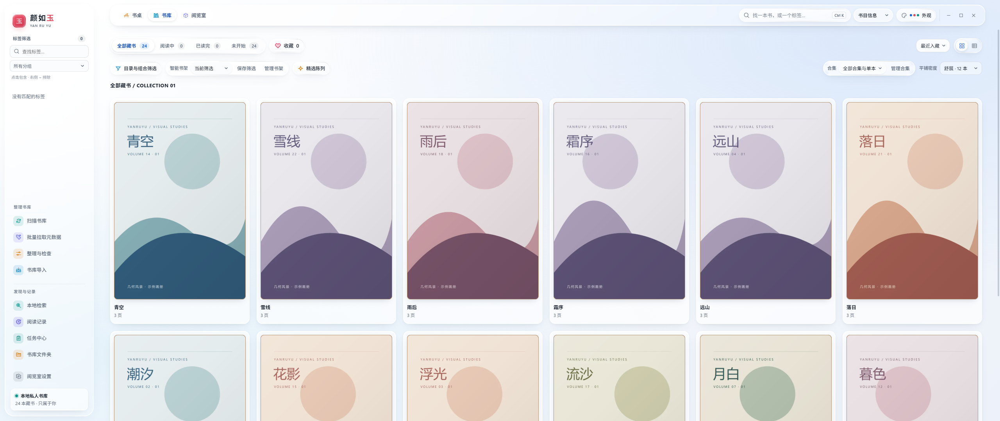

# 颜如玉 · 私人漫画阅览室

**中文** · [English](README.en.md)

颜如玉是一款面向 **Windows x64** 的本地漫画管理与阅读应用。选中存放漫画的目录，就能把图片文件夹和漫画压缩包整理成可检索的书库。从书桌继续上一页，在表格里批量整理，或在 3D 阅览室里按封面挑书。这些入口共用同一份书库和阅读档案。

**当前正式版 2.0.0** · [下载 Windows x64 ZIP][download] · [发布说明与校验文件][releases]

[快速开始](#快速开始) · [认识工作区](#认识工作区) · [整理与检索](#整理与检索) · [数据与升级](#数据与升级) · [开发](#开发)

## 界面预览

以下均为 2.0.0 成品在 2560 × 1080 下的实拍界面，使用独立示例书库。

**3D 阅览室**可按当前筛选摆放藏书，也可以陈列手动挑选的书。



**平铺书库**适合扫视封面。右上角可切换到表格，用于多选、排序和批量整理。



## 快速开始

1. 下载 `yanruyu-2.0.0-windows-x64.zip`，解压到独立文件夹，运行 `exhentai-manga-manager.exe`。日常使用无需安装 Node.js。[正式版下载][releases]
2. 在「书桌」点击「选择书库文件夹」，选中漫画所在的上级目录。扫描支持图片文件夹以及 ZIP、CBZ、7z、CB7、RAR、CBR 漫画包。应用会生成书目和封面，漫画正文仍在原位置。扫描进度可在「任务中心」查看。
3. 从书桌打开一册，或在书库点击封面查看详情，再进入阅读器。读过的书会出现在书桌的「继续阅读」和侧栏的「阅读记录」中。
4. 在「书库」切换封面或表格视图。想在 3D 书架上定位当前书籍，可从详情点击「在阅览室看」，再从房间返回书库原来的结果。

如需核验下载，在 ZIP 所在目录运行以下命令，将结果与 Release 附件 `SHA256SUMS.txt` 对照。[发布附件][releases]

```powershell
Get-FileHash -Algorithm SHA256 .\yanruyu-2.0.0-windows-x64.zip
```

## 认识工作区

| 入口 | 适合的操作 |
| --- | --- |
| **书桌** | 首次导入、新入藏、从上次页码和阅读模式继续、打开阅读记录和个人精选 |
| **书库** | 按封面浏览或用表格密集整理，组合目录、标签、收藏、阅读状态与合集筛选 |
| **阅览室** | 在独立的 3D 场景里浏览一组筛选结果，调整视角、陈列精选和布置房间 |
| **书籍详情** | 查看页数、来源路径、评分、标签和阅读进度，编辑单书、拉取元数据或重新定位文件 |

在书库与阅览室之间切换时，查询、排序、页码和选中的书会随工作区保留。可在「阅览室设置」选择启动页。

### 阅读器

- **单页**适合逐页翻阅，支持整页或适合宽度。**双页**可选封面独页，横向跨页图单独显示。**连续**模式可滚动阅读，并保留当前页内位置。
- 每本书分别保存阅读进度、阅读模式、方向、缩放和显示偏好。可用页码、滑块或缩略图跳页。常用快捷键包括 `G` 跳页、`T` 切换缩略图、`M` 切换模式和 `R` 切换方向。
- 「书页与切换」提供复制书页、将当前页设为封面、确认删页以及在当前筛选范围中切换书籍。可在「系统与阅读设置」选用外部阅读器。外部程序自行管理页码。
- 压缩包按需解压，默认缓存预算为 **2 GB**，可在设置中调整预算或清理空闲缓存。[阅读器与快捷键][manual]

### 3D 阅览室与主题

可拖动改变观察角度、用滚轮缩放书架，或用房间控制栏恢复视角。个人精选、视角、环境音和画质可按需要调整。外观提供 **暖白、静夜、纯白液态玻璃、EX 私人图库**四套主题，应用于书库、阅览室和阅读控件。性能设置提供省电、平衡与精细三档，WebGL 不可用时可通过封面视图继续浏览和阅读。[阅览室操作说明][manual]

## 整理与检索

- **筛选、合集和智能书架。** 合集由你手动添加或移除成员。智能书架保存一组查询、标签、收藏或阅读状态条件，新入库书目符合条件就会出现。目录树可连同子目录一起筛选。
- **单书与批量编辑。** 在详情中修改名称、作者或封面，在表格勾选多本后逐本预览标签、分类、评分和收藏等变化。支持的操作可以从「整理历史」撤销。
- **找回失联书目。** 移动书库或更换硬盘后，可从书籍详情使用「重新定位文件」。内容校验通过时沿用原书籍 ID、收藏和阅读档案。疑似重复项可先比对来源、内容指纹和进度，再决定保留本与进度来源。
- **页内文本和 OCR。** 顶部搜索可切换「书目信息」「书目与文本」「页内文本」，命中后跳到原书对应页。Windows OCR 依赖系统已安装的对应语言组件。可在本地检索中管理别名和查看相似推荐。
- **元数据来源和任务中心。** 书籍详情支持查询 E-Hentai、ExHentai、Hentag 或读取本地 `.ehviewer`。结果可逐字段选择后应用。任务中心会报告扫描、解压或元数据操作的状态，支持相应任务的取消与重试。[功能入口与验收矩阵][matrix]

## 数据与升级

### 程序、数据与漫画正文

| 保存方式 | 数据位置 |
| --- | --- |
| 普通运行 | Windows 当前用户的应用数据目录 |
| 便携模式 | 在程序旁创建 `data/`，或沿用旧版已有的 `portable` 标记 |
| 显式指定 | 将 `YANRUYU_DATA_DIR` 设为数据目录的绝对路径。此设置优先 |

数据目录保存书目、元数据、收藏和合集、阅读档案与设置。漫画正文仍位于扫描时选择的书库目录。可在「阅览室设置 → 备份与恢复」导出 `.yru-backup`，封面可选择包含，漫画正文需单独保管。恢复前可以预览和校验备份，应用会为当前数据保留恢复点。[数据目录与隔离验证][isolation]

### 从 1.6.16 或 2.0 预览版升级

1. 在旧版创建并验证备份，记下当前数据目录，然后退出旧版。
2. 将 2.0.0 解压到新目录。普通安装可在同一 Windows 用户下直接启动。便携版和自定义数据目录按指南将新版指向旧数据目录。
3. 检查书目、收藏、合集和实际续读页码，再更新日常快捷方式。旧版经典入口会进入 2.0 工作区，兼容的旧阅读档案会迁入统一阅读器。[完整升级与回退步骤][upgrade]

### 常见问题

| 情况 | 处理方式 |
| --- | --- |
| 升级后看到空书库 | 检查新版使用的数据路径，尤其是原来用 `portable` 标记或独立 `data/` 的情况 |
| 文件搬家后书还在，但打不开 | 确认新位置可访问，在书籍详情使用「重新定位文件」 |
| 大压缩包首次打开失败 | 查看任务中心的错误，核对磁盘空间和解压缓存预算 |
| 想换电脑阅读 | 同时搬迁或备份应用数据和漫画正文，恢复后核对书库路径及续读位置 |

## 开发

环境：**Windows x64、Node.js >=24.5.0、npm**。Electron 固定为 **44.3.0**，依赖版本由锁文件控制。首次安装、构建或测试需要联网获取依赖。

```powershell
npm ci
npm run dev
```

开发入口把当前源码和锁定生产依赖构建到新的 `.build/` 子目录，再启动 Electron。开发数据默认位于 `.dev-data/`，不会使用项目目录中的现有便携书库。修改源码后关闭开发窗口并重新运行。

| 命令 | 用途 |
| --- | --- |
| `npm run check` | JavaScript 语法、发布源文件允许列表与配置格式 |
| `npm run build:ui` | 类型检查 `src/renderer` 并用 Vite 生成 `resources/app/dist/app/`。`build`、`dev`、`test` 会自动执行；直接运行单个测试脚本或项目根目录的便携程序前需先执行一次 |
| `npm run typecheck` | 仅做 Vue / TypeScript 类型检查 |
| `npm test` | 精简工作区回归。用两本模拟书检查进入和离开阅览室、窄窗操作与封面降级 |
| `npm run test:engineering` | 数据路径隔离、发布允许列表与精简运行时检查 |
| `npm run test:desktop` | 使用中性测试书库验证真实 Electron、IPC、SQLite 与图片解码 |
| `npm run test:backup-desktop` | 验证备份导出、坏包拒绝、恢复与损坏恢复入口 |
| `npm run test:all` | 全量回归，包含隔离桌面测试。仅在排查报错需要扩大范围或用户明确要求时运行 |
| `npm run build` | 构建应用 staging，安装锁定生产依赖并生成源码哈希 |
| `npm run package` | 生成不含用户数据的 Windows x64 程序目录与 ZIP |
| `npm run package -- --preview` | 按预览模式打包，文件名包含完整应用版本 |
| `npm run release:audit` | 复核最近发布目录的数据排除规则与文件哈希 |
| `npm run compact -- --current --measure` | 测量当前程序的磁盘占用 |
| `npm run compact -- --current` | 无损压缩当前程序运行文件的磁盘占用 |

测试入口会在新 staging 安装运行依赖。历史脚本 `tools/test-desktop-gallery.cjs` 会读取真实书库，已从统一测试入口排除。测试产物位于被 Git 忽略的 `tools/.artifacts/` 或系统临时目录。

## 项目结构

| 路径 | 内容 |
| --- | --- |
| `resources/app/index.js`、`resources/app/modules/`、`resources/app/fileLoader/` | Electron 主进程、数据库与文件处理 |
| `resources/app/preload.js` | 受限桌面接口桥接 |
| `src/renderer/` | 新前端（Vue 3 + Pinia + TypeScript，Vite 构建）。UI 重构期间由它启动并承载原生界面，各页面逐步迁入 |
| `resources/app/dist/app/` | `src/renderer` 的构建产物，被 Git 忽略，勿手改 |
| `resources/app/dist/room*.js` 与配套模块、CSS | 原生阅览室前端源码，重构期间逐步迁入 `src/renderer` |
| `resources/app/dist/vendor/` | 随附前端依赖及许可证 |
| `resources/extraResources/` | 7-Zip 及随附许可证 |
| `tools/project/`、`tools/tests/` | 开发、构建、打包、审计与工程测试 |
| `docs/` | 使用、数据隔离、源码来源与工程文档 |

Vue 入口负责启动桌面工作区，阅览室及现有页面逻辑仍有一部分位于 `resources/app/dist/`。打包时，Vite 产物和这部分原生 JS/CSS 一起进入应用。

## 数据与发布边界

本地工作目录同时包含现有便携程序和私人书库，Git 使用允许列表，只提交源码、工具、锁文件、许可证和文档。数据库、配置、阅读状态、封面、浏览器资料、缓存、备份、安装运行时与构建输出均被排除。

发布脚本只创建新目录，从锁文件安装生产依赖，核验源码与程序文件哈希，并测试 ZIP 完整性。它不会覆盖现有安装或迁移书库。开发与测试的数据路径契约见 [数据目录与隔离验证][isolation]。

Windows NTFS 文件压缩仅减少实际磁盘占用，不改变文件内容或逻辑大小。解压或复制后压缩属性可能不保留，发布包内的 `优化程序磁盘占用.ps1` 可再次应用。详见 [程序体积与清理][footprint]。

## 文档与版本

- [文档索引][docs]
- [更新日志](CHANGELOG.md)
- [使用与升级][upgrade]
- [源码来源与恢复范围][provenance]
- [数据目录与隔离验证][isolation]
- [工程与发布验收][acceptance]

## 来源与许可

本项目基于 [SchneeHertz/exhentai-manga-manager][upstream] 的 `v1.6.15`，对应提交 `a55570b9920da5ffdd6a698c771bbd9a9d52248f`。保留上游署名，定制部分按 [MIT License](LICENSE) 提供。

Electron、Three.js、7-Zip 及其他依赖遵循各自随附的许可证。上游来源、保留二进制与源码恢复边界详见 [来源说明][provenance]。

[releases]: https://github.com/Gazesphotograph/YanRuYu-Reading-Room/releases/tag/v2.0.0
[upstream]: https://github.com/SchneeHertz/exhentai-manga-manager
[upgrade]: docs/使用与升级.md
[provenance]: docs/源码来源与恢复范围.md
[isolation]: docs/数据目录与隔离验证.md
[footprint]: docs/程序体积与清理.md
[docs]: docs/README.md
[acceptance]: docs/工程与发布验收.md
[download]: https://github.com/Gazesphotograph/YanRuYu-Reading-Room/releases/download/v2.0.0/yanruyu-2.0.0-windows-x64.zip
[matrix]: docs/颜如玉2.0功能验收矩阵.md
[manual]: 颜如玉阅览室说明.md
